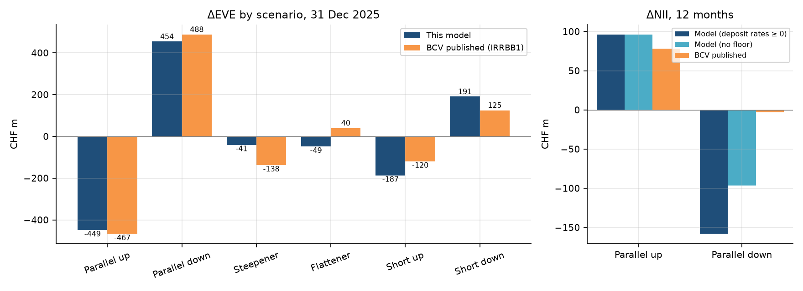
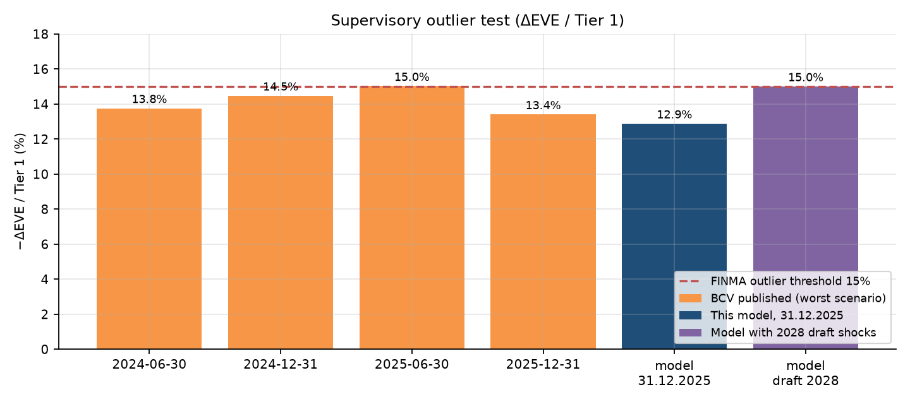
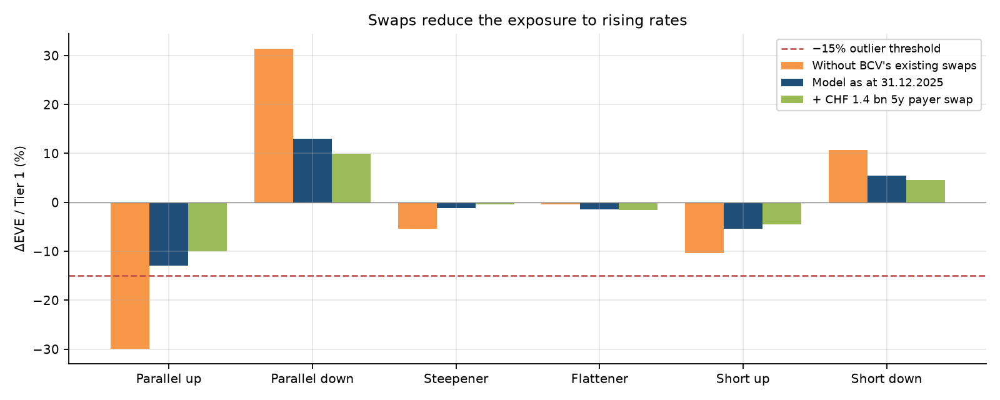

# Interest rate risk in the banking book (IRRBB) of a Swiss cantonal bank

Banque Cantonale Vaudoise (BCV) lends CHF 34 bn in fixed-rate mortgages for about four years on
average and funds them largely with sight and savings deposits that clients can withdraw at any
time. When rates move, the value of that balance sheet moves. FINMA asks every bank to measure the
change in economic value of equity (**ΔEVE**) and in net interest income (**ΔNII**) under six
standard shocks, and treats a bank as an *outlier* when ΔEVE exceeds **15% of Tier 1 capital**.

This project **rebuilds BCV's banking book from its public Pillar 3 report**, prices it on a CHF
curve fitted to SNB data, applies the six FINMA shocks, and compares the result with the numbers
BCV published at 31 December 2025. It then asks which assumptions drive the result (deposit
modelling, prepayment, hedging) and what would change under the 2028 FINMA draft.

Report (article, 11 pages): [`report/main.pdf`](report/main.pdf) · Walkthrough notebook: [`notebooks/walkthrough.ipynb`](notebooks/walkthrough.ipynb)

## Key results (parent bank, 31 Dec 2025, CHF m)

| Question | Result |
|---|---|
| Does the rebuilt book reproduce BCV's ΔEVE? | Parallel up **−449** vs −467 published (gap 3.9%); parallel down **+454** vs +488 (gap 7.0%). Twist and short-rate shocks differ more (RMSE over the six scenarios: 68) |
| Outlier test (worst ΔEVE / Tier 1 of 3,484) | **12.9%** in the model vs **13.4%** published: below the 15% threshold, but close. On BCV's own published figures the ratio was 15.02% at 30 June 2025 |
| FINMA 2028 draft (CHF parallel 175 bp, short 250 bp) | the model reaches **15.0%**, i.e. the threshold; BCV's published parallel-up figure scaled to 175 bp gives 15.6% |
| ΔNII, 12 months | parallel up **+96** vs +78 published. Parallel down **−158** vs −3: deposit rates are already near 0% and cannot fall further; BCV's figure assumes it can pass negative rates on and earn SNB tiering gains |
| Deposit pass-through (SNB data, Jun 2022 – Dec 2025) | savings rates follow SARON with **beta 0.35** (R² 0.75), payment accounts 0.01, variable mortgages 0.11 |
| How much does the deposit model matter? | halving the stable share of sight deposits moves the parallel-up loss from 449 to **674** (19.3% of Tier 1, an outlier). The six published ΔEVE are best matched with 100% stable sight deposits and 16% stable savings (RMSE 29) |
| Existing hedges | without BCV's CHF 12.9 bn of payer swaps the worst ratio would be **29.9%**: the swaps cut the exposure by more than half |
| Extra hedge | a **CHF 1.39 bn 5-year payer swap** at 0.10% brings the worst ratio to 10.0% (11.7% under the 2028 shocks), raises ΔNII-up from 96 to 117 and costs about 2 m a year of carry at current rates |
| Prepayment option | with BCV's compensation penalty, the down shock gains +454. Without a penalty, a refinancing response of +5% CPR per 100 bp fall turns it into a **loss of 402** |





## Method in one paragraph

The 18 lines of BCV's repricing table (IRRBBA1, Pillar 3 p.53-54) become positions: each block
with a contractual repricing date is a ladder of monthly tranches whose average maturity equals
the published one; non-maturity deposits are split into a volatile part (overnight) and a stable
part replicated up to the published maximum tenor (5 years for sight, 10 years for savings), so
that the published average (1.8 years) is matched. Coupons of the stock come from SNB rates on new
business averaged over the origination window. The CHF zero curve is a Svensson fit to the 22
Confederation bonds and SARON on 30 Dec 2025 (fit error 1.8 bp). The six shocks follow BCBS
SRP31 / FINMA Circular 2019/2 (CHF: 150/150/100 bp, no floor); the code reproduces FINMA's printed
shock table exactly. ΔEVE revalues every cash flow on the shocked curve; ΔNII rolls over what
reprices within 12 months on a constant balance sheet, with client rates that follow market rates
with the estimated pass-through and cannot go below zero.

## Project structure

```
src/
  curve.py        Svensson zero curve, discount factors, par swap rate
  shocks.py       the six Basel / FINMA shocks and time buckets
  model.py        positions, cash flows (ladders, NMD, prepayment), ΔEVE, ΔNII, payer swap
  bcv.py          BCV's IRRBBA1 table + documented assumptions -> positions
  nmd.py          deposit pass-through regression, stable share
  data.py         loading the saved SNB and BCV data
scripts/
  01_download_data.py          BCV and FINMA PDFs, SNB data portal cubes
  02_curve_and_inputs.py       curve, shocks, coupons, pass-through   -> figures 1-2
  03_irrbb.py                  ΔEVE / ΔNII vs published, gaps, outlier -> figures 3-6
  04_nmd_prepayment_hedge.py   deposit sensitivity, prepayment, swaps  -> figures 7-9
data/raw/                      the public PDFs and SNB CSVs as downloaded
data/processed/                BCV tables transcribed by hand (page numbers inside)
results/                       every number of the report (JSON / CSV)
tests/test_core.py             13 tests (FINMA shock table, curve fit, duration, NII, data totals)
report/                        LaTeX source (article class), references, compiled PDF
```

## Reproduce

```bash
python -m venv .venv && .venv/Scripts/activate      # or source .venv/bin/activate
pip install -r requirements.txt
python run_all.py              # recompute everything from the saved data + run tests
python run_all.py --download   # download the PDFs and SNB data again first
```

The report compiles with `latexmk -pdf main.tex` in `report/`, or by uploading
`report/overleaf_upload.zip` to Overleaf (New project → Upload project).

## Data and limitations

- **Public data only, no account**: BCV Pillar 3 reports (31.12.2025 and 31.12.2024) and annual
  report 2025 (bcv.ch); FINMA Circular 2019/2 consultation draft of 4 Nov 2026 (finma.ch), whose
  tracked changes show the shock table in force; SNB data portal (SARON, Confederation bond
  yields, client rates on new business).
- **Aggregated balance sheet**: 18 lines with an average repricing date each, not loan-level
  data. The shape of each ladder (uniform) is an assumption.
- **Curve**: BCV discounts with the SARON swap curve, which is not free; the Confederation curve is
  used instead (a +20 bp parallel spread changes ΔEVE by at most 2 m).
- **Coupons**: proxies from SNB averages. The implied run-rate net interest (656 m) is above the
  reported 2025 figure (519 m), so the cash flows probably carry too much margin; removing all
  margins lowers the parallel-up ΔEVE to −361.
- **Deposits**: BCV's replication model (12-month moving-average volatile part, rate and volume
  effects) is not public; ours only matches its published averages.
- **ΔNII**: constant balance sheet, instantaneous shock, no SNB tiering, no negative-rate
  charges, EUR/USD (6% of the balance sheet) treated as CHF.
- **2028 draft**: only the parallel and short CHF sizes are read from the draft; the long shock
  is kept at 100 bp.

## References

Basel Committee (2016, SRP31); FINMA Circular 2019/2; Nelson & Siegel (1987); Svensson (1994);
Hutchison & Pennacchi (1996); Jarrow & van Deventer (1998); Kalkbrener & Willing (2004);
Drechsler, Savov & Schnabl (2017, 2021). Full list in
[`report/references.bib`](report/references.bib).

Author: Andreas Kyrlakis, MSc in Finance, HEC Lausanne.
